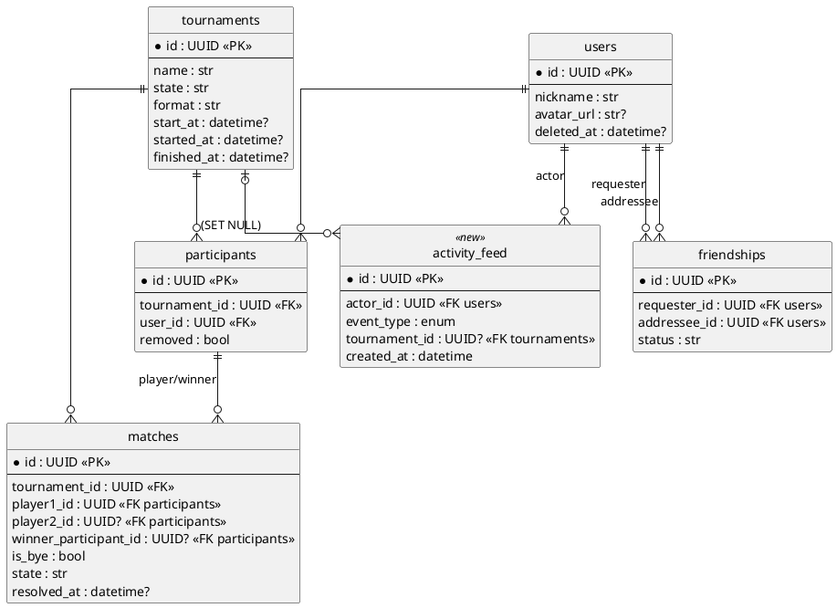

# Phase 1 — Data Model: Dashboard (005)

Esta feature **añade una sola tabla** (`activity_feed`) y **no modifica** ninguna tabla
existente. El esquema de 001 (`users`, `token_blacklist`), 002 (`tournaments`,
`participants`, `invitations`, `matches`, `notifications`), 003 (`riot_accounts` + columnas
en `users`) y 004 (`friendships`) se conserva intacto. El resto de datos del dashboard se
**leen** de esas tablas existentes; no se persiste ningún snapshot de métricas.

---

## Entidad nueva: `activity_feed`

Evento de actividad escrito en el momento de la acción (Decisión 3 de `research.md`).

| Columna | Tipo | Restricciones | Notas |
|---------|------|---------------|-------|
| `id` | UUID | PK, default `uuid4` | Igual patrón que el resto de modelos. |
| `actor_id` | UUID | FK → `users.id` `ON DELETE CASCADE`, `NOT NULL`, indexado | Usuario que originó el evento. CASCADE: si se borra el usuario, sus eventos desaparecen. |
| `event_type` | str(20) / Enum | `NOT NULL`, `CHECK` ∈ {`MATCH_WIN`,`TOURNAMENT_JOIN`,`TOURNAMENT_INVITE`,`TOURNAMENT_CREATE`} | Enum no nativo (`native_enum=False`, `create_constraint=True`), igual estilo que `friendship_status` en [friendship.py:55-65](../../backend/app/models/friendship.py#L55-L65). |
| `tournament_id` | UUID | FK → `tournaments.id` `ON DELETE SET NULL`, nullable, indexado | SET NULL para conservar el evento del actor aunque el torneo se borre (FR-022, Decisión 7). |
| `created_at` | datetime(tz) | `NOT NULL`, default `now(utc)` | Marca de tiempo del evento; base del orden cronológico (FR-020) y del "tiempo transcurrido". |

**Índices**:
- `idx_activity_actor_created` sobre `(actor_id, created_at DESC)` — sirve la consulta
  principal del feed (filtrar por actores [yo + amigos] y ordenar por recencia).

**Modelo SQLAlchemy** (destino `backend/app/models/activity_feed.py`), siguiendo el estilo de
los modelos existentes (`Mapped`/`mapped_column`, `from __future__ import annotations`):

```python
class ActivityFeed(Base):
    __tablename__ = "activity_feed"
    __table_args__ = (
        Index("idx_activity_actor_created", "actor_id", "created_at"),
    )
    id: Mapped[uuid.UUID] = mapped_column(Uuid(as_uuid=True), primary_key=True, default=uuid.uuid4)
    actor_id: Mapped[uuid.UUID] = mapped_column(
        Uuid(as_uuid=True), ForeignKey("users.id", ondelete="CASCADE"), index=True, nullable=False
    )
    event_type: Mapped[str] = mapped_column(
        Enum("MATCH_WIN", "TOURNAMENT_JOIN", "TOURNAMENT_INVITE", "TOURNAMENT_CREATE",
             name="activity_event_type", native_enum=False, create_constraint=True,
             validate_strings=True),
        nullable=False,
    )
    tournament_id: Mapped[uuid.UUID | None] = mapped_column(
        Uuid(as_uuid=True), ForeignKey("tournaments.id", ondelete="SET NULL"), index=True, nullable=True
    )
    created_at: Mapped[datetime] = mapped_column(
        DateTime(timezone=True), default=lambda: datetime.now(timezone.utc), nullable=False
    )
```

**Migración Alembic**: una revisión nueva `CREATE TABLE activity_feed` (+ índices + enum
check). `head` actual de migraciones: la cadena 001→004 termina en
`e2a4b5c7d9f1_notification_friendship_fk`; la nueva revisión cuelga de ahí. No hay
`ALTER TABLE` sobre tablas existentes.

---

## Entidades existentes leídas (sin cambios de esquema)

| Entidad | Tabla | Uso en el dashboard | Campos leídos |
|---------|-------|---------------------|---------------|
| Usuario | `users` | Saludo (nickname); resolución de actor en el feed; filtro `deleted_at IS NULL` | `id`, `nickname`, `avatar_url`, `deleted_at` |
| Torneo | `tournaments` | Mis torneos; nombre/estado/formato/fecha; nombre en el feed | `id`, `name`, `state`, `format`, `start_at`, `started_at`, `finished_at` |
| Participación | `participants` | Determina torneos del usuario y mapea match→usuario | `tournament_id`, `user_id`, `removed` |
| Partida | `matches` | Victorias, winrate, streak | `is_bye`, `state`, `winner_participant_id`, `player1_id`, `player2_id`, `tournament_id`, `resolved_at`, `round_number` |
| Invitación | `invitations` | Evento `TOURNAMENT_INVITE` (instrumentación) | `inviter_user_id`, `tournament_id` |
| Amistad | `friendships` | Filtro de visibilidad del feed; nº de amigos | `requester_id`, `addressee_id`, `status` |

---

## Reglas de validación (derivadas de requisitos)

- **FR-008 (sin datos)**: winrate con denominador 0 → devolver `0` y `winrate=null`/`0.0`
  (sin división por cero). Variación semanal sin histórico → `null`/neutro, no porcentaje.
- **FR-019 (visibilidad)**: un evento solo es visible si `actor_id == current_user.id` o
  existe `friendship` `accepted` entre `current_user` y `actor_id` **en el momento de la
  consulta**.
- **FR-022 (resiliencia)**: `tournament_id` puede ser `null` (torneo borrado) → entrada sin
  enlace de torneo. Actor anonimizado (`users.deleted_at != null`) → no debería aparecer
  (filtro), y si apareciera, render sin enlace.
- **FR-023 (aislamiento)**: ninguna consulta acepta un `user_id` externo; todas parten de
  `current_user.id`.
- **Streak**: solo cuenta partidas con `is_bye=False` y `state != 'pending'`; consecutividad
  evaluada por `resolved_at` ascendente, reiniciada en cada torneo.

---

## Diagrama (PlantUML — Constitution III)

> Fuente PlantUML para que un humano lo renderice. Solo entidades relevantes al dashboard.


